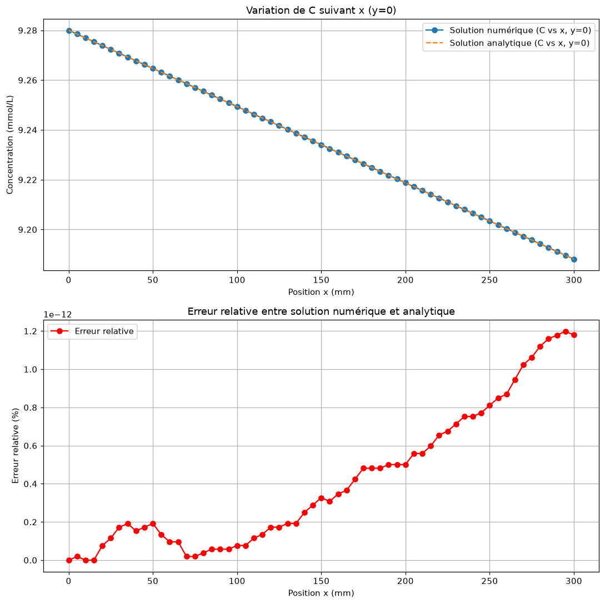
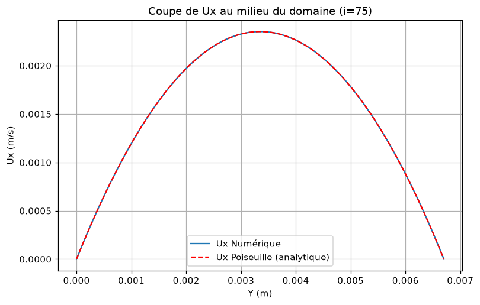
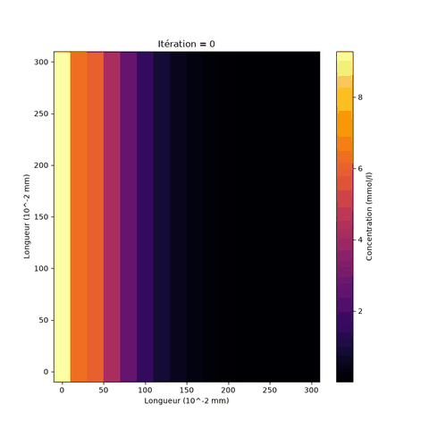

# Pulmonary gas exchange: 2D diffusion and convection models

Finite-difference simulations of oxygen transport in the lung: diffusion in a 2D section of an acinus and air convection in a 2D channel, in steady state and over time, on simple and deformed geometries.

## Context

- Biomedical engineering project at EMINES (UM6P), November 2024 to January 2025, supervised by Marcel Filoche.
- Team of eight students (Group 1). The full report (in French) is in [docs/rapport_Biomedical_Groupe01.pdf](docs/rapport_Biomedical_Groupe01.pdf), with a short user guide in [docs/guide_utilisation.pdf](docs/guide_utilisation.pdf).

## What was done

- **Steady diffusion**: the domain is discretized on a regular grid, the diffusion equation and the boundary conditions (Dirichlet at the inlet, Robin condition ∂C/∂n = −C/Λ on the exchange surface, Neumann elsewhere) are written as a sparse linear system and solved with SciPy.
- **Deformed geometries**: a Tkinter interface to draw obstacles (rectangle, ellipse, polygon) and choose the boundary conditions before running the diffusion solver.
- **Time-dependent diffusion**: Crank-Nicolson scheme (Δt = 1/144 s), animated until the steady state is reached.
- **Convection**: velocity and pressure fields of a flow driven by a pressure difference, in a straight channel, around obstacles, and over time (explicit Euler in time).
- **Validation**: diffusion compared with the analytical 1D solution, convection compared with the Poiseuille profile and flow rate.

## Results

Numbers printed by the scripts when run as provided:

- Diffusion (`diffusion_sans_def.py`): the numerical concentration matches the analytical solution with a relative error around 1e-12 %, and the inflow equals the outflow (1.243e-4 ml/s).
- Convection (`convection_sans_def_2.py`, 150 × 150 grid): relative L2 error on the velocity Ux of 1.2e-7 against Poiseuille, and relative error on the flow rate of 4.5e-5.

| Diffusion vs analytical solution | Convection vs Poiseuille profile |
|:---:|:---:|
|  |  |

*Left: numerical vs analytical concentration along x and relative error. Right: simulated velocity profile vs Poiseuille.*



*Transient diffusion (Crank-Nicolson) from `diffusion_temporel.py`, until the steady state; the colour scale is rescaled at each frame.*

## Running it

Requirements: Python 3.8+ with Tkinter (included in the standard Windows and macOS installers; on Ubuntu: `sudo apt install python3-tk`).

```bash
git clone https://github.com/RedaMohssine/pulmonary-gas-exchange.git
cd pulmonary-gas-exchange
pip install -r requirements.txt
```

Each script runs on its own and opens matplotlib windows:

```bash
python diffusion/diffusion_sans_def.py       # steady diffusion + analytical validation
python diffusion/diffusion_avec_def.py       # Tkinter interface to draw a deformed domain
python diffusion/diffusion_temporel.py       # time evolution (Crank-Nicolson), saves a GIF

python convection/convection_sans_def_2.py   # channel flow + Poiseuille validation
python convection/convection_avec_def.py     # flow around obstacles
python convection/convection_temporel.py     # time evolution, saves a GIF
```

For `convection_avec_def.py`, the deformation is set by the `Deff` function in the script (see the user guide).

## Repository structure

```
diffusion/
  diffusion_sans_def.py     steady diffusion, rectangular domain, analytical validation
  diffusion_avec_def.py     steady diffusion on a domain drawn in a Tkinter window
  diffusion_temporel.py     transient diffusion (Crank-Nicolson) and animation
convection/
  convection_sans_def.py    channel flow, first version
  convection_sans_def_2.py  channel flow with Poiseuille validation
  convection_avec_def.py    flow with obstacles
  convection_temporel.py    transient flow and animation
docs/
  rapport_Biomedical_Groupe01.pdf   full report (French)
  guide_utilisation.pdf             user guide (French)
  images/                           figures and animation generated by the scripts
```

## Limitations

- The models are 2D and use simplified geometries; a real acinus is 3D and branched.
- The convection model is a Stokes-type flow at low Reynolds number; inertia and the coupling between convection and diffusion are not modelled.
- Grid sizes are set in the scripts (for example `N = 150`); finer grids make the sparse systems slow to build because the matrices are assembled point by point in Python.
